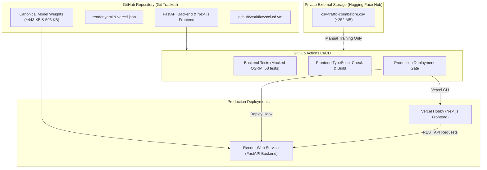

# ApexGuardian V2.0 — Production Deployment & Free-Tier CI/CD Guide

This guide details the deployment architecture, configuration, and CI/CD pipelines for **ApexGuardian V2.0**, designed to operate within modern free-tier limits without compromising data integrity or application performance.

---

## 1. System Architecture & Storage Separation



### Storage Boundaries
- **In Git**: Source code, small configuration/JSON cache files (`coverage_anchors_coimbatore.json`, `osrm_cache_coimbatore.json`), lightweight trained model weights (`congestion_model_coimbatore_synthetic_v1.pkl` [443 KB] and `congestion_model_v3_fixed.pkl` [506 KB]).
- **Never in Git (Ignored)**: The 252 MB Coimbatore CSV (`ApexGuardian/backend/ml/datasets/cbe/csv-traffic-coimbatore.csv`), local virtual environments (`.venv/`, `venv/`), `.next/`, `node_modules/`, and `.env` secret files.
- **In Private Hugging Face Hub**: The 252 MB Coimbatore traffic dataset for historical backup and deliberate model retraining.

---

## 2. Hugging Face Hub: One-Time Dataset Upload

The 252 MB Coimbatore dataset is stored in a private Hugging Face Dataset repository.

### Dataset Metadata
- **File Name**: `csv-traffic-coimbatore.csv`
- **File Size**: 251,885,940 bytes (~252 MB)
- **SHA-256 Checksum**: `07d185de5333cc477782ac6a44d8595d3032024fd81ff7bd559d0b64a0c58612`

### One-Time Upload Instructions (via Python or Git Bash)
1. Install the Hugging Face CLI:
   ```bash
   pip install huggingface_hub
   ```
2. Log in with your Hugging Face Access Token (requires `write` scope):
   ```bash
   huggingface-cli login
   ```
3. Create a **private** dataset repository (e.g., `your-username/apexguardian-coimbatore-traffic`):
   ```bash
   python -c "
   from huggingface_hub import HfApi
   api = HfApi()
   api.create_repo(repo_id='your-username/apexguardian-coimbatore-traffic', repo_type='dataset', private=True)
   "
   ```
4. Upload the local CSV file directly:
   ```bash
   python -c "
   from huggingface_hub import HfApi
   api = HfApi()
   api.upload_file(
       path_or_fileobj='ApexGuardian/backend/ml/datasets/cbe/csv-traffic-coimbatore.csv',
       path_in_repo='csv-traffic-coimbatore.csv',
       repo_id='your-username/apexguardian-coimbatore-traffic',
       repo_type='dataset'
   )
   print('Upload complete.')
   "
   ```
*(Note: Normal CI, app startup, and frontend deployments never download this dataset).*

---

## 3. Backend Deployment: FastAPI on Render

Render provides a free web service tier suitable for running the FastAPI backend.

### Service Configuration
The repository includes a ready-to-use [`render.yaml`](file:///e:/PROJECTS/ApexGuardian%20V2.0/render.yaml) blueprint:
- **Root Directory**: `ApexGuardian/backend`
- **Environment**: Python 3.11.9
- **Build Command**: `pip install --upgrade pip && pip install -r requirements.txt`
- **Start Command**: `uvicorn main:app --host 0.0.0.0 --port $PORT`
- **Health Check Path**: `/api/v1/health`
- **Auto-Deploy**: `false` (deployments are triggered securely via GitHub Actions CI)

### Render Environment Variables
Configure these in the Render Dashboard (or via Blueprint):
| Variable | Value | Description |
| :--- | :--- | :--- |
| `ACTIVE_REGION` | `coimbatore` | Sets Coimbatore as the active navigation & model region |
| `ENVIRONMENT` | `production` | Production mode |
| `CORS_ORIGINS` | `["http://localhost:3000", "https://your-frontend.vercel.app"]` | JSON array of permitted frontend origins |
| `OSRM_BASE_URL` | `https://router.project-osrm.org` | OpenStreetMap routing engine |
| `NOMINATIM_BASE_URL`| `https://nominatim.openstreetmap.org` | OpenStreetMap geocoding |
| `MODEL_WEIGHTS_PATH`| `ml/weights/congestion_model_coimbatore_synthetic_v1.pkl` | Path to production model artifact |

### Getting the Deploy Hook
In Render: **Service Settings &rarr; Deploy Hook &rarr; Copy URL**. Store this URL as the GitHub secret `RENDER_DEPLOY_HOOK`.

---

## 4. Frontend Deployment: Next.js on Vercel

The frontend is built with Next.js 14 and deployed onto Vercel's Hobby tier.

### Vercel Project Setup
1. In the Vercel Dashboard, select **Add New &rarr; Project** and import your GitHub repository.
2. In **Project Settings**:
   - **Root Directory**: Set to `ApexGuardian/frontend` (crucial: do not build from repo root).
   - **Framework Preset**: `Next.js`
   - **Build Command**: `next build` (or leave default)
   - **Output Directory**: `.next` (default)
3. Set **Environment Variables**:
   | Variable | Value |
   | :--- | :--- |
   | `NEXT_PUBLIC_API_BASE_URL` | `https://<your-render-backend>.onrender.com/api/v1` |
   | `NEXT_PUBLIC_ACTIVE_REGION` | `coimbatore` |

*(Note: Verify that `NEXT_PUBLIC_API_BASE_URL` ends in `/api/v1` without a trailing slash).*

---

## 5. GitHub Actions CI/CD Pipeline

The workflow defined in [`.github/workflows/ci-cd.yml`](file:///e:/PROJECTS/ApexGuardian%20V2.0/.github/workflows/ci-cd.yml) gates production deployments behind strict automated tests:

### Pipeline Flow
1. **`backend-ci`**:
   - Sets up Python 3.11.
   - Installs dependencies from `ApexGuardian/backend/requirements.txt`.
   - Runs `python -m compileall -q .` to check for syntax errors.
   - Executes the complete test suite: `python -m pytest -q` (all 68 tests run fully offline with zero network calls).
2. **`frontend-ci`**:
   - Sets up Node.js 20.
   - Installs packages using `npm ci`.
   - Executes strict TypeScript type validation: `npx tsc --noEmit`.
   - Executes production static build: `npm run build`.
3. **`deploy`**:
   - Runs **only** on pushes to `main` when both CI jobs pass.
   - If `RENDER_DEPLOY_HOOK` is present &rarr; triggers Render deploy hook.
   - If `VERCEL_TOKEN`, `VERCEL_ORG_ID`, `VERCEL_PROJECT_ID` are present &rarr; deploys to Vercel via CLI.
   - If secrets are unconfigured, logs a clear informational notice and gracefully completes without failing.

### Repository Secrets & Variables

Navigate to **GitHub Repository &rarr; Settings &rarr; Secrets and variables &rarr; Actions**:

#### Secrets (`Repository secrets`)
- `RENDER_DEPLOY_HOOK`: Webhook URL from Render Service Settings.
- `VERCEL_TOKEN`: Personal Access Token from [Vercel Account Tokens](https://vercel.com/account/tokens).
- `VERCEL_ORG_ID`: Found in `ApexGuardian/frontend/.vercel/project.json` (or Vercel team/account settings).
- `VERCEL_PROJECT_ID`: Found in `ApexGuardian/frontend/.vercel/project.json` (or Vercel project settings).
- `HF_TOKEN` *(Optional)*: Read-only Hugging Face access token for the manual training workflow.

#### Variables (`Repository variables`)
- `NEXT_PUBLIC_API_BASE_URL`: Production backend API base URL (e.g., `https://apexguardian-backend.onrender.com/api/v1`).

---

## 6. Verification & Health Checks

Once deployed, verify end-to-end functionality:

### 1. Backend Health Check
```bash
curl -i https://<your-backend>.onrender.com/api/v1/health
```
Expected response:
```json
{
  "status": "online",
  "region": "Coimbatore",
  "region_key": "coimbatore",
  "training_data_is_synthetic": true,
  "features": ["congestion_point_identification", "predictive_congestion", "dynamic_alternative_rerouting"]
}
```

### 2. CORS Verification
```bash
curl -i -X OPTIONS https://<your-backend>.onrender.com/api/v1/health \
  -H "Origin: https://<your-frontend>.vercel.app" \
  -H "Access-Control-Request-Method: GET"
```
Verify `Access-Control-Allow-Origin` matches your frontend domain.

### 3. Routing Smoke Test
```bash
curl -i -X POST https://<your-backend>.onrender.com/api/v1/route \
  -H "Content-Type: application/json" \
  -d '{
    "origin_lat": 11.0247,
    "origin_lon": 77.0030,
    "dest_lat": 11.0323,
    "dest_lon": 77.0266
  }'
```
Expected response: HTTP 200 with route candidates and `region: "coimbatore"`.

---

## 7. Free-Tier Constraints & Caveats

Please keep the following provider limitations in mind:

- **Render Free Tier**:
  - Web services on the free tier spin down after 15 minutes of inactivity. The next request may experience a **cold start** delay (approx. 30–50 seconds).
  - Free instances have 512 MB RAM. The backend was specifically optimized to load the lightweight 443 KB XGBoost model without retaining the 252 MB raw CSV in memory.
  - Review [Render Free Tier Limits](https://render.com/docs/free).
- **Vercel Hobby Tier**:
  - The Hobby tier is intended for non-commercial personal / college / research projects.
  - Review [Vercel Fair Use Guidelines](https://vercel.com/docs/limits/overview).
- **Public OSRM & Nominatim**:
  - Public demo endpoints (`router.project-osrm.org`, `nominatim.openstreetmap.org`) are subject to community rate limits (1 req/sec for Nominatim). For heavy production use, consider dedicated tiles/routing containers.

---

## 8. Rollback & Troubleshooting

- **Backend Rollback**: In Render Dashboard, open **Deploys** &rarr; select any previous successful build &rarr; click **Rollback to this deploy**.
- **Frontend Rollback**: In Vercel Dashboard, open **Deployments** &rarr; locate the previous deployment &rarr; click **Instant Rollback**.
- **Model Fallback**: If the Coimbatore model artifact is ever missing, the inference engine safely falls back to standard baseline routing (multiplier `1.0`) without raising a 500 error.
